# VoxLua

**Make little 3D voxel worlds by writing tiny Lua programs, then bring them to life with animation.**

Created by **[pyro-22](https://github.com/pyro-22)**.

A cozy place to learn programming: type a few lines, watch cubes appear, change a number, watch
them change. Then export your creation to [Godot](https://godotengine.org/) and use it in a real game.

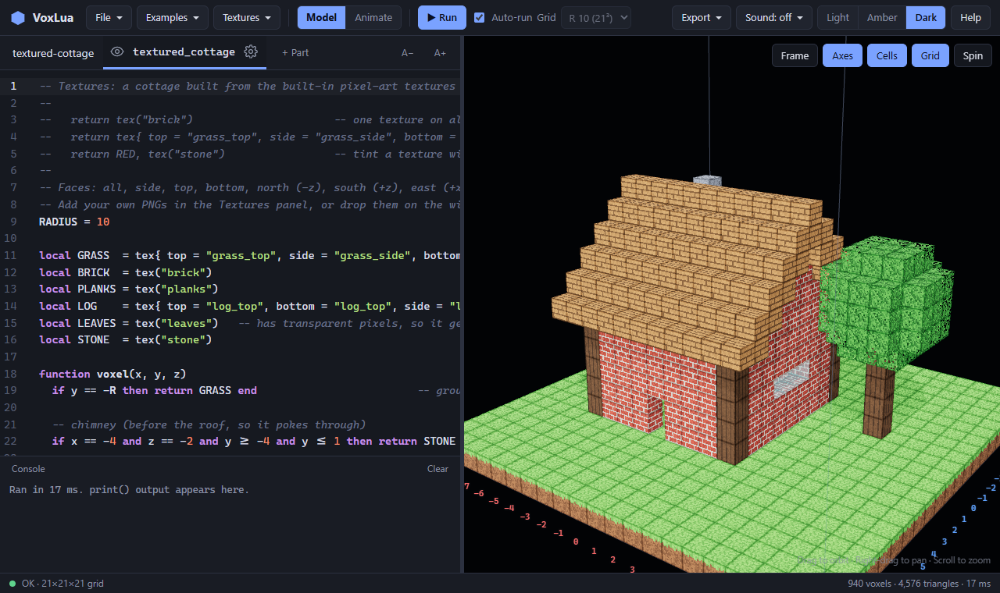

> **Early concept.** VoxLua is young and still changing, but it already works: you can model,
> texture, animate and export today. Expect rough edges.

## Heavily inspired by Replicube

VoxLua is heavily inspired by **[Replicube](https://www.walaber.com/replicube)** by Walaber
Entertainment ([Steam](https://store.steampowered.com/app/3401490/Replicube/)), a lovely
programming puzzle game where you write Lua to recreate voxel objects. If you enjoy VoxLua, go play
Replicube. It is wonderful, and it is where the idea of `voxel(x, y, z)` comes from.

VoxLua is not affiliated with Walaber Entertainment. Where Replicube is a puzzle game, VoxLua is a
free-form workshop: no levels, just you making things, with extras like textures, animation and
export to a game engine. It's meant for **kids, beginners, and anyone who wants to learn**, taking
their first steps with Lua.

## Why VoxLua exists

Programming is an art, and it might be lost forever. Future generations may grow up knowing what
AI agents are, but never learn how computers think, or how fun it is to type a few words of
syntax and watch something come alive.

VoxLua is a small place where that art stays alive, for kids, for beginners of any age, and for
anyone who has ever wondered how a computer actually follows instructions.

- **Creativity is a way of learning.** We learn by creating: try something, watch it break, try
  again. Kids do this naturally when they play, and it works just as well at 15, 40 or 70.
  Trial and error *is* the lesson.
- **Mistakes are always allowed.** In VoxLua, errors explain instead of scold, and your last
  working model stays on screen while you fix things. Nobody is "bad at coding"; everyone starts
  with a red line.
- **Every creation deserves to exist.** A wobbly sword or a lopsided house made with your own
  hands is worth more than a perfect one someone else made. Export it, put it in a game, show it
  to the world.
- **Don't let AI create everything for learners.** The struggle, the "aha!" and the pride of
  making something yourself are the whole point, whether you're a kid, a student, or an adult
  writing your very first line of code.
- **Syntax can be fun.** `if`, `then`, `return RED`: a few small words, and cubes appear.

*VoxLua itself was built with the help of AI tools, so that kids and beginners don't have to:
they get a cozy place to write the code themselves.*

### Made for teaching and learning

VoxLua is free and open source (MIT), and it exists to be used for education: to teach programming,
and to learn it, whether in a classroom or on your own.

**Let creativity stay alive forever.**

---

## Contents

- [Why VoxLua exists](#why-voxlua-exists)
- [Getting started](#getting-started)
- [Tutorial 1: Your first shape](#tutorial-1-your-first-shape)
- [Tutorial 2: Colors, see-through and shiny](#tutorial-2-colors-see-through-and-shiny)
- [Tutorial 3: Patterns with math](#tutorial-3-patterns-with-math)
- [Tutorial 4: Textures](#tutorial-4-textures)
- [Tutorial 5: Finding your way around](#tutorial-5-finding-your-way-around)
- [Tutorial 6: When something goes wrong](#tutorial-6-when-something-goes-wrong)
- [Tutorial 7: Building with parts](#tutorial-7-building-with-parts)
- [Tutorial 8: Animating with the mouse](#tutorial-8-animating-with-the-mouse)
- [Tutorial 9: Animating with code](#tutorial-9-animating-with-code)
- [Tutorial 10: Taking it to Godot](#tutorial-10-taking-it-to-godot)
- [Lua in two minutes](#lua-in-two-minutes)
- [Keyboard shortcuts](#keyboard-shortcuts)
- [Ideas for teachers and self-learners](#ideas-for-teachers-and-self-learners)
- [Status and roadmap](#status-and-roadmap)

---

## Getting started

You need [Node.js](https://nodejs.org/) (version 22 or newer). Then, in this folder:

```bash
npm install
npm run dev
```

Open **http://localhost:5173** in Chrome or Edge. (Other browsers work too; Chrome and Edge can also
save straight back to the files you opened.)

Everything you need is inside the app: **Examples** has ready-made models to explore, and **Help**
lists every color, material and function.

---

## Tutorial 1: Your first shape

VoxLua asks one question for every little cube in the grid: *"what goes here?"*
You answer by writing a function called `voxel`:

```lua
function voxel(x, y, z)
  if len(x, y, z) <= 7 then
    return RED
  end
end
```

- `x`, `y` and `z` say **where** the cube is. They go from `-R` to `R` (the grid's *radius*), and
  `y` points up.
- `len(x, y, z)` is the distance from the center, so "closer than 7" makes a **ball**.
- `return RED` fills the cube. Returning nothing leaves it empty.

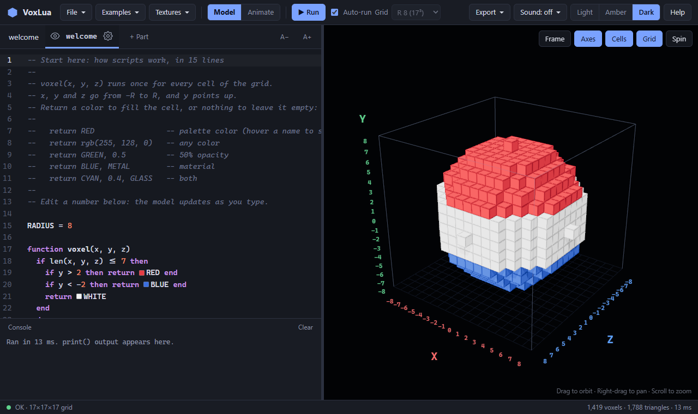

Try changing `7` to `4`. The model updates **as you type**, so you can play with numbers and see
what happens right away:

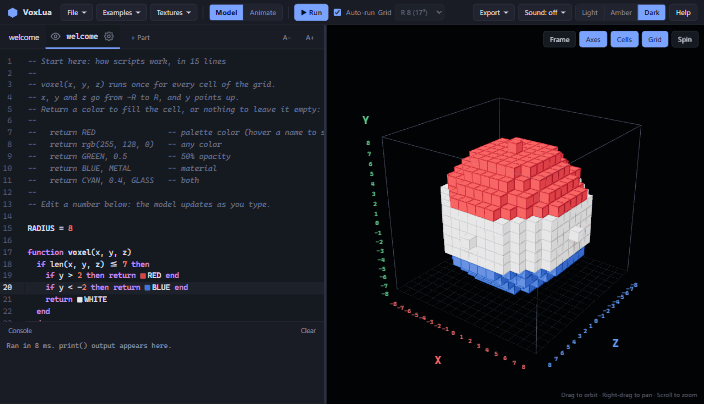

> **Tip:** `RADIUS = 8` at the top of a script sets the grid size (x, y and z from -8 to 8).
> Without it, the **Grid** menu in the top bar decides.

---

## Tutorial 2: Colors, see-through and shiny

After the color you can add an **opacity** (0 is invisible, 1 is solid) and a **material**, in
either order:

```lua
return GREEN                 -- a palette color (hover a name in the editor to see it)
return GREEN, 0.5            -- half see-through
return GRAY, METAL           -- shiny metal
return CYAN, 0.4, GLASS      -- see-through glass
return YELLOW, GLOW          -- it glows!
return rgb(255, 128, 0)      -- any color you like: rgb(), hex(0xff8000), hsv(0.08, 1, 1)
```

The materials are `MATTE`, `PLASTIC`, `METAL`, `CHROME`, `GLASS` and `GLOW`:

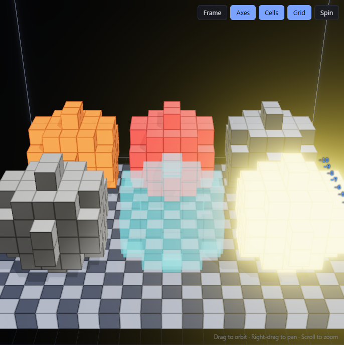

---

## Tutorial 3: Patterns with math

A few lines of math can make surprising things. Some favorites:

```lua
-- a 3D checkerboard
if (x + y + z) % 2 == 0 then return WHITE end

-- a rainbow: hsv() turns a number between 0 and 1 into a color of the rainbow
return hsv(x / 20, 1, 1)

-- bumpy hills: noise() gives smooth random numbers between 0 and 1
if y < noise(x / 8, 0, z / 8) * 10 - 5 then return GREEN end
```

Open **Examples** to see more: a rainbow donut, an island with see-through water, a Menger sponge
fractal, a little city with glowing windows, a heart from a math formula...

---

## Tutorial 4: Textures

Give cubes pixel-art textures with `tex()`:

```lua
return tex("brick")                                        -- the same texture on every face
return tex{ top = "grass_top", side = "grass_side", bottom = "dirt" }
return RED, tex("stone")                                   -- tint a texture with a color
```

VoxLua comes with grass, dirt, stone, brick, planks, logs and leaves. You can **add your own PNGs**
from the **Textures** menu, or just drop image files on the window. Transparent pixels become holes,
which is perfect for leaves.

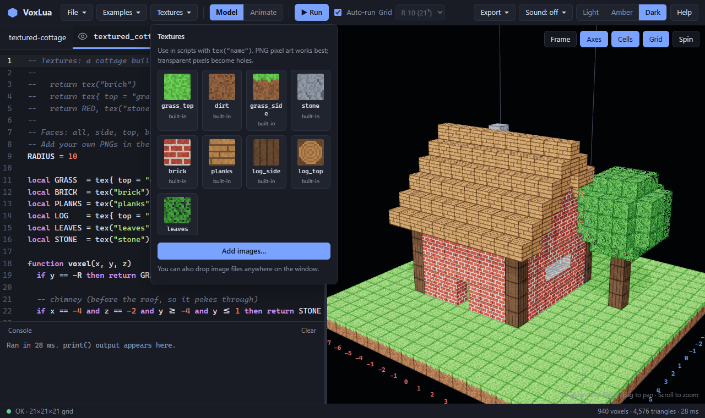

---

## Tutorial 5: Finding your way around

Lost? Turn on **Axes** (top right of the 3D view) to see numbered X, Y and Z rulers, and **hover
any cube** to see exactly where it is, plus its color and material:

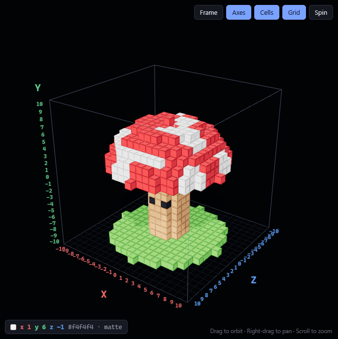

- **Cells** draws an outline around every cube, so you can count them even on flat walls.
- **Frame** brings the camera back. Drag to orbit, right-drag to pan, scroll to zoom.
- Pick the look you like: **Light**, **Amber** (a cozy retro screen) or **Dark**.

<p>
  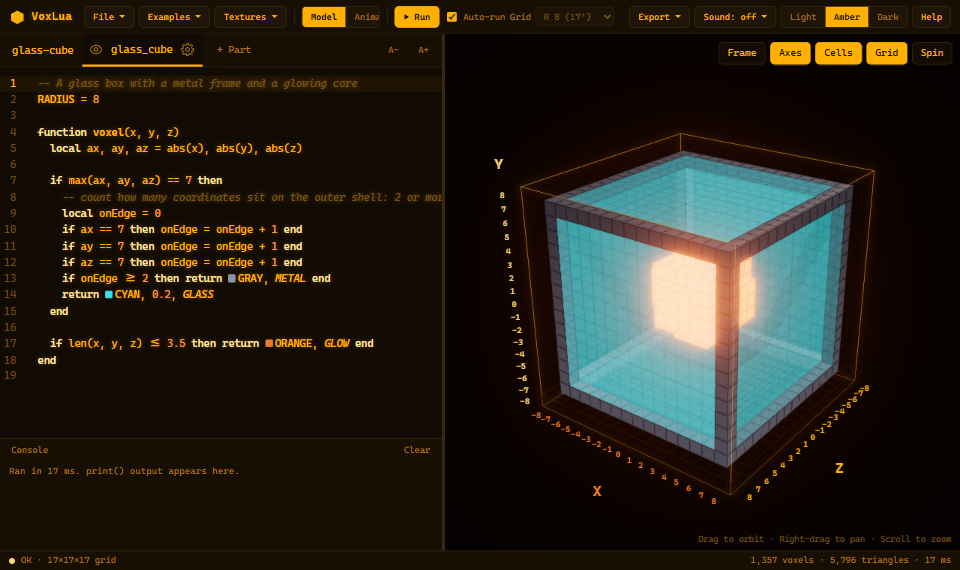
  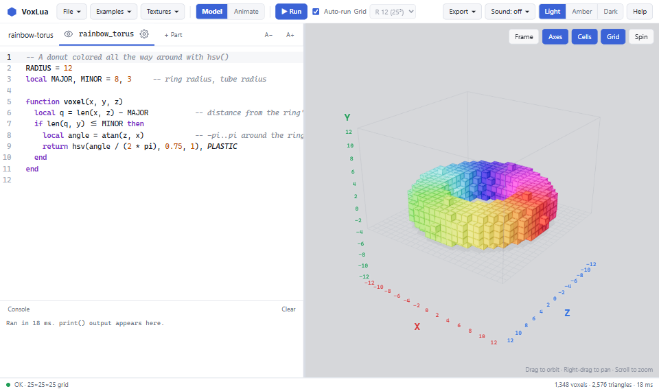
</p>

---

## Tutorial 6: When something goes wrong

Mistakes are part of learning, so VoxLua tries to explain them kindly. The line turns red, the
console says what happened (and which cube was being computed), and **your last working model stays
on screen** while you fix it. Click the line number in the console to jump there.

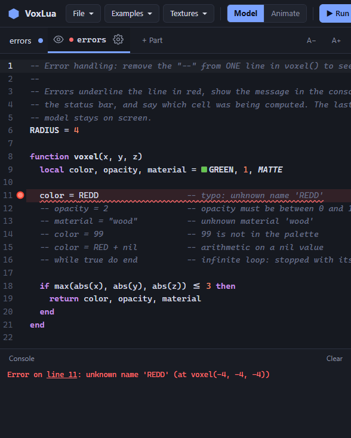

Open **Examples → Errors** and remove the `--` from one line at a time to see the different
messages. Even an infinite loop is safe: it gets stopped with its line number.

---

## Tutorial 7: Building with parts

Bigger models are easier in pieces. Each **part** is a tab above the editor with its own `voxel()`
script. All parts share the same grid, so draw each piece where it belongs.

- **+ Part** adds a part. Double-click a tab to rename it.
- The **eye** on a tab hides that part so you can see what's behind it (Alt+click shows only
  that part). Hidden parts are still saved and exported.
- The **gear** opens the part's settings:
  - **Pivot**: the point the part turns around, like a shoulder or the hilt of a sword.
  - **Parent**: the part moves along with its parent (the blade follows the handle).

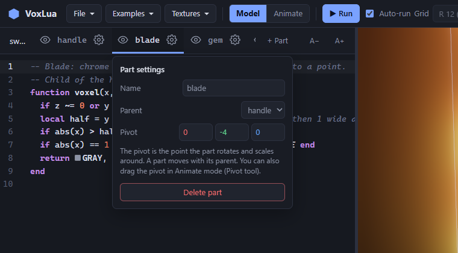

---

## Tutorial 8: Animating with the mouse

Switch to **Animate** in the top bar. A timeline appears at the bottom, and every part gets a row.
(Back in **Model** mode, all of that hides away again.)

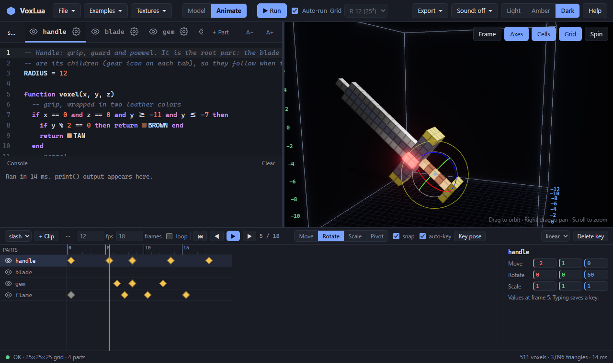

1. **Click a part** in the 3D view (or its name in the timeline).
2. **Pick a tool**: **Move** (W), **Rotate** (E), **Scale** (R), or **Pivot** (P) to drag the pivot.
3. **Drag the gizmo.** When you let go, a **keyframe** (a diamond) is saved at the current frame.
4. **Go to another frame** (click the ruler, or press `,` and `.`), pose again, and VoxLua fills
   in the motion between your keyframes.
5. Press **Space** to play.

More things you can do:

- Drag diamonds to change their timing. Alt+drag copies one. Delete removes the selected one.
- Choose how the motion moves away from a key: **linear**, **ease**, **in**, **out**, or **step**
  (jump with no in-between, like pixel art).
- Snapping keeps moves to whole cubes and turns to 15° steps. Hold **Shift** to move freely.
- Make several **clips** (like `idle` and `attack`) with **+ Clip**.
- Hide a part by scaling it to 0, and pop it in later. That's how the sword's flame appears:

<p>
  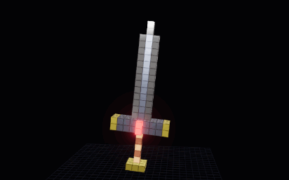
  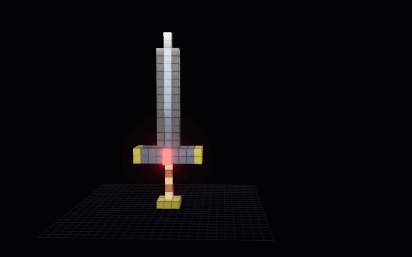
</p>

Open **Examples → Sword (animated)** and switch to Animate to explore it.

---

## Tutorial 9: Animating with code

Everything you do with the mouse is also written as code in the **▶ Animation** tab, and you can
edit it there too. Change a number and the timeline updates; pose with the mouse and the code updates.

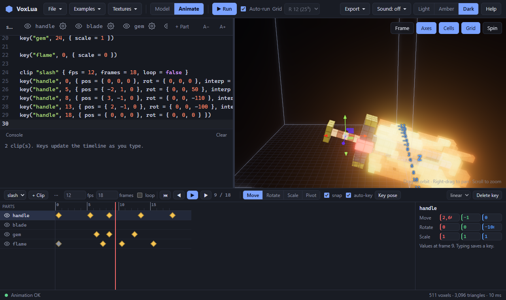

```lua
clip "slash" { fps = 12, frames = 18, loop = false }

key("handle", 0, { rot = { 0, 0, 0 } })
key("handle", 5, { rot = { 0, 0, 50 }, interp = "in" })     -- wind up
key("handle", 8, { rot = { 0, 0, -110 }, interp = "out" })  -- strike!

key("flame", 0, { scale = 0, interp = "step" })             -- hidden...
key("flame", 7, { scale = 1.3 })                            -- ...then WHOOSH

for f = 0, 24, 6 do                                         -- loops can make keys too
  key("gem", f, { pos = { 0, sin(f / 24 * 2 * pi), 0 } })
end
```

- `pos` moves the part (in cubes), `rot` turns it (in degrees around x, y, z), `scale` grows or
  shrinks it.
- `interp` decides how the motion travels to the next key.

---

## Tutorial 10: Taking it to Godot

Click **Export**:

- **GLB** (recommended): your model, colors, materials, textures, **parts** and **animations** in
  one file. Drop it into a Godot project. Each part becomes a node, and each clip shows up in the
  AnimationPlayer (clips set to loop get a `_loop` ending so Godot loops them).
- **OBJ**: the model in its rest pose, for other tools.
- **Voxel size** sets how big one cube is in meters (0.1 by default).

Save your work with **File → Save**. A simple model saves as a `.lua` file; a model with parts or
animation saves as a folder with readable files (`project.json`, `parts/*.lua`, `animations.lua`).

<p align="center">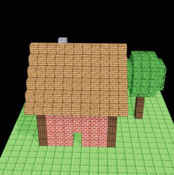</p>

---

## Lua in two minutes

A few things that surprise people coming from other languages:

| In Lua... | Example |
|---|---|
| "Not equal" is `~=` | `if x ~= 0 then` |
| Only `nil` and `false` count as false. **`0` counts as true!** | `if 0 then` runs |
| Variables are global unless you write `local` | `local d = len(x, y, z)` |
| Lists start at **1** | `colors[1]` is the first one |
| `/` gives decimals; `//` rounds down | `7 / 2` is `3.5`, `7 // 2` is `3` |
| `%` (remainder) stays positive, even for negatives | `-1 % 3` is `2`, handy for patterns |
| Blocks end with `end`; `elseif` is one word | `if a then ... elseif b then ... else ... end` |
| Text is joined with `..` | `"x is " .. x` |
| There's no `+=` | `i = i + 1` |
| `and` / `or` can pick a value | `local c = (y > 0) and RED or BLUE` |
| Functions can return several values | `return GREEN, 0.5, GLASS` |
| Comments start with `--` | `-- this is a note` |

---

## Keyboard shortcuts

| Keys | What it does |
|---|---|
| `Ctrl` + `Enter` | Run (scripts also re-run as you type) |
| `Ctrl` + `S` / `Ctrl` + `Shift` + `S` | Save / Save as |
| `Ctrl` + `O` | Open |
| `Ctrl` + `Space` | Show suggestions |
| `Ctrl` + `F` | Find and replace |
| `Space`, `,` / `.` | Animate mode: play / pause, previous / next frame |
| `W` `E` `R` `P` | Animate mode: move, rotate, scale, pivot tool |
| `K` | Animate mode: save the shown pose as a keyframe |
| `Delete` | Animate mode: delete the selected keyframe |

And for fun: **Sound** in the top bar turns on keyboard click sounds, including a clicky "blue switch".

---

## Ideas for teachers and self-learners

VoxLua works well in small steps, each one a single new idea. Teach them in this order, or follow
them on your own:

1. **Return a color.** `return RED` fills the whole grid. Then use one coordinate: `if y < 0 then`.
2. **Comparisons and `and`/`or`.** Boxes: `if abs(x) <= 3 and abs(y) <= 3 and abs(z) <= 3 then`.
3. **Distance.** Balls and rings with `len()`.
4. **Variables and `local`.** Name your numbers: `local size = 5`.
5. **Remainder `%`.** Stripes and checkerboards.
6. **Functions and math.** `sin`, `hsv`, `noise`: waves, rainbows, landscapes.
7. **Tables and loops.** A list of positions, `for` loops (see Examples → Materials).
8. **Animation.** Pose with the mouse, then read and change the generated code.

Every example in the **Examples** menu starts with a comment explaining what it shows.

---

## Status and roadmap

VoxLua is an **early concept**. Working today: modeling with Lua, colors, opacity, materials,
textures, parts, animation (mouse and code), saving projects, and GLB/OBJ export.

Coming next, in order of priority:

1. **A desktop app (Electron)**: the top priority, so VoxLua can be installed and run without a
   browser or any setup.
2. **States**: flipbook frames for things like flickering fire.
3. **Look keys**: animate glow, tint and opacity.
4. **Onion skin**, copy/paste poses, and undo for posing.

Known rough edges:

- The keyboard **click sounds** need more ironing out. I know, and they're on the list.

## Built with

[three.js](https://threejs.org/) (3D), [wasmoon](https://github.com/ceifa/wasmoon) (real Lua 5.4
in the browser), [CodeMirror](https://codemirror.net/) (the editor) and [Vite](https://vitejs.dev/).

For contributors, [CLAUDE.md](CLAUDE.md) describes how the code is organized.

## Credits

VoxLua is created by **[pyro-22](https://github.com/pyro-22)**.

The idea of building voxel models with a `voxel(x, y, z)` function comes from
**[Replicube](https://www.walaber.com/replicube)** by Walaber Entertainment. Thank you for the inspiration!

## License

[MIT](LICENSE): free to use, change and share, in classrooms and anywhere else.
